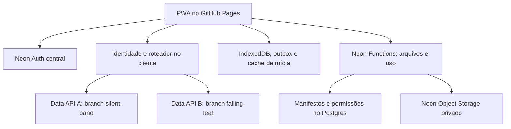

# Viaggio — auditoria da arquitetura em 15/11/2026

## Escopo e grau de certeza

Auditoria do código de `paulosince/viagens`, referência remota `d878c57862285efcd8e93be272891261cbeae00b`, branches Git, arquivos efetivamente servidos pelo GitHub Pages, configurações e catálogos dos projetos Neon conectados, respostas HTTP sem credenciais dos serviços de mídia, testes locais e painel Cloudflare. Consultas ao banco foram somente leitura. Nenhum dado, arquivo de usuário, senha, configuração de autenticação ou fotografia foi alterado.

Não foi possível inspecionar o inventário da conta Cloudflare: o painel redirecionou para `/login`. A sessão autenticada mencionada anteriormente não está disponível neste navegador desta auditoria. Não houve teste autenticado no iPad nem captura dos cookies naquele aparelho. Esta auditoria não declara o problema de login resolvido e não é certificação de segurança completa.

## 1. Produção efetiva

O frontend atual é `https://paulosince.github.io/viagens/`. Foram baixados `index.html`, `login.html`, `sw.js`, `experiments/neon-pilot/app/backend-neon.mjs` e `src/login-neon.mjs`: todos retornaram HTTP 200 e foram comparados byte a byte com o checkout, sem divergência.

`index.html` verifica primeiro a outbox legada. Se houver trabalho Supabase ainda não enviado, abre `legacy-supabase.html?recover=1`. Caso contrário, importa `experiments/neon-pilot/app/main-neon.js`. Portanto, o nome `experiments` NÃO significa que esse código seja dispensável ou apenas de testes.

| Camada | Implementação efetiva |
|---|---|
| Interface | HTML/CSS, JavaScript ESM, `main-neon.js` com aproximadamente 9 mil linhas |
| Login | documento separado `login.html`, `src/login-neon.mjs` |
| SDK | jsDelivr, `@neondatabase/neon-js@0.9.0-beta`, `postgrest-js@0.2.0-beta`; adaptador compatível com Supabase |
| Identidade | Neon Auth central; mapeamento do UUID novo para UUID legado autorizado no banco |
| Dados | duas Neon Data APIs, agregadas pelo cliente |
| Arquivos | Neon Functions, manifesto no Postgres, bucket privado Neon Object Storage |
| Offline | IndexedDB `viaggio-neon-auth-preview-v1`, outbox, snapshots e Cache Storage |
| Publicação atual | GitHub Pages; workflows de verificação do app publicado |
| Legado preservado | Supabase, página de recuperação, antigo plugin MCP e keepalive |
| Protótipo de novo host | `deployment/first-party-auth`, não implantado; NÃO apto para produção |

## 2. Cloudflare: o que foi comprovado

**Atualização posterior à auditoria inicial (15/11):** capturas fornecidas pelo usuário mostram o projeto **Pages `viagens`**, endereço **`viagens-cc8.pages.dev`**, com deployment recente incluindo o commit desta auditoria. Portanto, a ausência de acesso ao painel neste ambiente não significa ausência de hospedagem ativa. O usuário também salvou no Registro.br `dahlia.ns.cloudflare.com` e `jaxson.ns.cloudflare.com`; a captura de 13h56 informa aproximadamente duas horas de transição. Ainda não foi comprovada a ativação do domínio personalizado, seu TLS ou sua associação ao Pages. Os parágrafos seguintes registram as observações anteriores, não o estado atual de DNS.

**Preparação posterior:** o service worker passou a excluir `/api`, `/viagens/api` e requisições same-origin com Authorization antes de qualquer acesso ao cache. Testes executam o handler do SW e verificam ausência de interceptação; o shell continua disponível offline. O adaptador `deployment/first-party-auth/cloudflare.mjs` usa Request/Response e bindings de ambiente, falhando com 503 sem configuração. Testes locais Node não equivalem a validação no runtime Cloudflare nem no iPad. Nenhum endpoint de autenticação ativo foi trocado.

Existe a branch `cloudflare/workers-autoconfig`, cujo último commit é `0beb8e3ba4a3a5c359f79a4cfa88f498ecd4abec`, de 05/06/2026, criado por `cloudflare-workers-and-pages[bot]`. Seu `wrangler.jsonc` declara:

- Worker chamado `viagens`;
- `assets.directory = "."`;
- `nodejs_compat`;
- observabilidade habilitada;
- nenhuma entrada `main`, proxy de autenticação, binding de banco ou bucket nessa configuração.

O commit está contido apenas naquela branch remota, não em `main`. Não há `wrangler` nem `CNAME` na árvore atual de `main`. A consulta aos commit statuses daquela revisão não retornou registros; isso NÃO prova que jamais houve deploy. A configuração comprova integração/autoconfiguração histórica, mas não comprova serviço ativo nem identifica seu endereço público atual.

DNS consultado pelo resolvedor público em 15/11: `ioviaggio.com.br` teve NS `a.auto.dns.br` e `b.auto.dns.br`, sem resposta A ou CNAME no domínio raiz. Não foram auditados todos os subdomínios nem AAAA. Portanto, não há evidência nesta consulta de que o domínio raiz já aponte ao app ou use nameservers Cloudflare.

A Cloudflare suporta assets e lógica dinâmica no mesmo Worker. Vercel não é requisito arquitetural. A escolha anterior de Vercel ocorreu antes de verificar essa infraestrutura e não deve orientar uma migração.

Fontes: [configuração histórica](https://github.com/paulosince/viagens/blob/cloudflare/workers-autoconfig/wrangler.jsonc), [Workers com assets](https://developers.cloudflare.com/workers/static-assets/binding/).

## 3. Inventário Neon e roteamento

| Papel | Projeto | Branch usada |
|---|---|---|
| Autenticação | `dark-union-03886858` / viaggio-auth-beta | `br-square-river-b765bpl4` / main; DB `viaggio_auth` |
| Dados A | `fragrant-credit-68065034` / viaggio-lab-onboarding-01 | `br-silent-band-b80nklzl` / auth-federation-validation-20261020; DB `viaggio_lab` |
| Dados B | `sparkling-field-13794641` / viaggio-lab-onboarding-02 | `br-falling-leaf-b8xuv1d0` / auth-federation-validation-20261020; DB `viaggio_lab` |
| Mídia histórica | os dois projetos anteriores | também branches main `br-dawn-bread-b83r0ztn` e `br-proud-paper-b83l1z7d` |
| Experimentos separados | `blue-grass-62654431`, `raspy-brook-57888252` | projetos ioviaggio-spike-core/user; não referenciados no backend ativo examinado |

As Data APIs retornaram status ativo e URLs exatamente iguais às constantes `API_ROOTS`. Ambas expõem `public`, `viaggio_collab`, `viaggio_app`, têm limite de 1000 linhas, role anônima `anonymous` e CORS restrito a `https://paulosince.github.io`.

O roteador consulta os dois projetos e combina resultados. Perfil pessoal e nova viagem são encaminhados para o projeto identificado por `project_context`. Edição resolve o projeto que contém a viagem/dia/registro. Ausência, duplicidade ou erro de um projeto impedem sucesso silencioso. Consequência: a indisponibilidade de um projeto pode impedir o login completo e leituras do outro, mesmo para dados pessoais.

Há uma camada de compatibilidade significativa, não uma simples troca de URL Supabase por Neon. `neon-identity.mjs` remapeia IDs após JWT e RLS. `viaggio_identity.uid()` exige role authenticated, vínculo `dual_session` verificado/ativado e usuário válido. Não usar o UUID central diretamente nas tabelas antigas.

As tabelas dos três schemas de aplicação/colaboração/identidade consultados têm RLS habilitada nas duas branches de produção. A política `project_personal_profile` é RESTRICTIVE, combinada com as políticas próprias do usuário; não é uma permissão geral ao perfil do dono. As funções de manifesto e acesso de mídia são SECURITY DEFINER, com search_path vazio e checagem explícita do usuário e da participação na viagem. Isso foi inspecionado; não substitui testes adversariais completos de todas as políticas e funções.

## 4. Arquivos: destinos distintos que não devem ser unificados às cegas

`backend-neon.mjs` possui três mapas separados:

| Chave | Leitura de fotos/perfis (`MEDIA`) | Leitura de tickets | Escrita |
|---|---|---|---|
| A | proud-paper / appmedia | silent-band / appmedia | silent-band / appwrite |
| B | dawn-bread / appmedia | falling-leaf / appmedia | falling-leaf / appmedia |

O cruzamento aparente das leituras de fotografias é real no código atual. Foi preservado conforme instrução do usuário; a auditoria não revalidou cada foto autenticada nem alterou esse mecanismo.

Tickets usam download privado com JWT, recebem bytes e criam uma URL blob local. Fotos/perfis usam o caminho de assinatura existente. O servidor consulta `media_read_manifest`, autoriza com RLS, lê o objeto privado e confere tamanho/SHA-256. Upload valida tipo/tamanho/conteúdo, grava e relê o objeto antes de registrar os metadados. A remoção normal marca a referência como removida e preserva os bytes; uma falha na criação pode limpar o objeto recém-criado ainda não registrado.

Nas quatro branches verificadas há bucket privado `viaggio-lab-media`. Functions ativas foram listadas no Neon: appmedia nas quatro; appwrite em silent-band; appusage nas duas branches de dados; além de funções antigas de teste/migração. Não foi baixado/comparado o bundle implantado de cada função, portanto fonte local e versão implantada não foram declaradas idênticas.

Inventário agregado nas branches de dados: A tem 4 viagens e 9 registros de anexos; B tem 1 viagem e nenhum anexo. Manifestos ativos ready: A tem 11 objetos de anexos, 7 de perfis e 66 de fotos; B tem 1 de perfil e 4 de fotos. Quantidade de objetos não equivale à quantidade de tickets (capas e versões podem existir); não excluir nada com base nessa diferença. Esses totais são metadados, não uma verificação física de todos os arquivos.

O limite CHECK de `day_attachments.size_bytes` foi confirmado como 20 MiB (20.971.520 bytes) nas duas branches, alinhado ao limite de frontend. O gateway tem teto mais amplo de 25.000.000 bytes.

## 5. Login do iPad: localização exata da falha

Fluxo: formulário → `signInWithPassword` do SDK → `sign-in/email` → `getSession` → JWT → `project_context` nos dois projetos → perfil → remapeamento → página principal.

A foto D2 mostra senha HTTP 200 e get-session HTTP 200 sem sessão. No código do adaptador oficial instalado, `signInWithPassword` chama sign-in, depois getSession; se falta `session.user`, lança exatamente `Failed to retrieve user session`. Portanto, a falha observada ocorre antes da tradução do perfil e das consultas às viagens. O diagnóstico não mostra erro de RLS ou de senha; também não captura o cookie para comprovar a causa final.

O auth atual é cross-origin/cross-site em relação ao GitHub Pages. Cookies bloqueados, particionados, não enviados ou uma divergência de recuperação de sessão são hipóteses a discriminar no aparelho. Não há evidência suficiente para escolher entre elas somente pela foto D2. O service worker atual ignora as requisições externas de auth (não são imagens nem assets externos enumerados); esse cache não explica diretamente a sessão vazia atual.

Configuração central lida: trusted origin GitHub Pages; localhost permitido; email/senha e cadastro habilitados no provedor; Google configurado; logs_export nulo. O frontend, porém, desabilita `signUp` no facade, apesar de exibir “Criar conta”. Permissão de cadastro no provedor não cria automaticamente vínculo com os dados legados/projeto pessoal.

## 6. Offline, sessão e atualização

IndexedDB guarda identidade de usuário e estado local, não uma sessão de servidor reutilizável. O boot offline exige identidade Neon previamente verificada e cópia local. Com rede, exige sessão Neon e correspondência da dupla UUID central/legado antes de reutilizar cache. O logout limpa a identidade cacheada, mas conserva dados locais. O boot online sem sessão encaminha para login.

Isso explica por que existir uma viagem visível no Safari não prova que outro contexto PWA tenha os mesmos dados/sessão. Não foi verificado o armazenamento efetivo de ambos no iPad. Também não há mecanismo próprio do app que transfira sessão entre esses contextos.

O service worker usa app-shell versionado e preserva caches de mídia; o gerenciador condiciona ativação às pendências/estado local. Imports transitivos do SDK vêm do CDN: testes offline em runtime real ainda são necessários, além do precache das entradas principais. O offline de um domínio não migra automaticamente ao publicar em outro.

## 7. Achados que impedem a publicação do protótipo de outro domínio

1. **CORS/origens incompletos.** Além do Neon Auth, Data APIs e Functions restringem a origem. Quatro appmedia responderam HTTP 401 AUTH_REQUIRED sem credencial com origem atual e HTTP 403 ORIGIN_DENIED com origem fictícia diferente. Mudar apenas authUrl quebraria os arquivos e as consultas.
2. **Cache indevido de auth no mesmo domínio.** Reproduzido com o `sw.js` real em VM local e resposta fictícia: GET `/api/auth/get-session` é interceptado e enviado para Cache Storage mesmo com resposta no-store. Cache API explícita não é evitada pelo código atual. Não houve uso de token real. Antes de qualquer novo host, excluir explicitamente todas as rotas auth/API dessa estratégia e verificar login, refresh e logout.
3. **Teste de proxy não é teste integral.** Os testes prévios validam cookies e proxy isolados, não o navegador junto ao service worker, origens dos dados, RLS, sessão persistida e mídia.
4. **Pacote de publicação incompleto.** O build whitelist deve conferir todo recurso referenciado (por exemplo `icon-180.PNG` é referenciado no HTML e não entra na lista de cópia). A verificação de precache sozinha não cobre todos os recursos.
5. **Migração de origem requer estratégia.** Novo endereço não atualiza magicamente o ícone instalado nem leva consigo IndexedDB/outbox. Manter o app atual e preservar toda fila pendente é obrigatório.

A pasta `deployment/first-party-auth` é um protótipo suspenso, não uma solução pronta. Não foi implantada.

## 8. Outros débitos concretos

- Política UPDATE de anexos, nas duas branches, contém `d.trip_id = d.trip_id` em duas subconsultas. A comparação é tautológica e não prova vínculo do dia/atividade à viagem do anexo. Há outras verificações de membro/RLS; isso não demonstra acesso indevido por si só, mas a regra precisa de correção e testes isolados. Consulta somente leitura em A não encontrou anexos existentes com dia de outra viagem.
- Fluxos de cadastro, funções genéricas como Unsplash e exclusão de conta continuam apresentados/implementados parcialmente, mas o backend facade os bloqueia como indisponíveis. Separar recurso desabilitado de falha operacional na interface.
- Plugin MCP versionado ainda aponta ao Supabase; no app Neon `VIAGGIO_MCP_URL` está vazio. Não presumir que o plugin conectado opere o mesmo banco que a PWA.
- Comentários de staging/read-only contrastam com a utilização em produção e escrita habilitada. A nomenclatura induz erros de manutenção.
- Duas branches não padrão são produção real. Não executar migrações na branch main por convenção.
- Configuração distribuída entre frontend, Functions, banco, workflows e provedor; falta um inventário canônico de endpoints/origens/versões.
- Testes antigos de router importam `router.mjs`, não `router-neon.mjs`. Foram repetidos com import temporário do router de produção e passaram. Ajustar cobertura permanente futuramente.

## 9. Verificações executadas e limites

- cinco arquivos live idênticos ao checkout;
- inventário dos cinco projetos Neon e branches;
- configuração de Auth, duas Data APIs, Functions e quatro buckets;
- catálogos RLS, funções principais e limite de anexos nas branches efetivas;
- oito probes GET sem credenciais nas quatro Functions de mídia;
- 12 cenários de roteador executados contra o módulo de produção por adaptação temporária do import: passaram;
- testes de uso/armazenamento: 10 passaram;
- seis arquivos de teste de login isolado, diagnóstico, tickets/zoom, outbox e atualização: passaram;
- reprodução sintética do cache incorreto de auth same-origin: confirmada;
- nenhuma simulação foi tratada como validação no iPad.

## 10. Sequência de trabalho a partir desta auditoria

1. Inspecionar a conta Cloudflare autenticada: Worker `viagens`, bindings, domínio workers.dev/customizado, branch/build e último deployment, sem alterar recursos.
2. Completar a evidência do iPad: presença/aceitação/envio de cookie e resposta de sessão, sem registrar valores secretos. D2 já localiza a etapa; repetir o mesmo teste sem nova observação não resolve a causa.
3. Escolher o menor ajuste comprovadamente necessário. Se adotar mesma origem, priorizar a infraestrutura existente e validar adapter/runtime, exclusões de cache, trusted origins, CORS e recuperação offline.
4. Testar em endereço separado com duas contas: login, reload, refresh, logout, reabertura PWA, isolamento RLS, visualização/upload dos anexos e fotos preservadas.
5. Só então decidir publicação/migração do endereço, mantendo arquivos e registros existentes. Não anunciar sucesso antes da validação do iPad.
